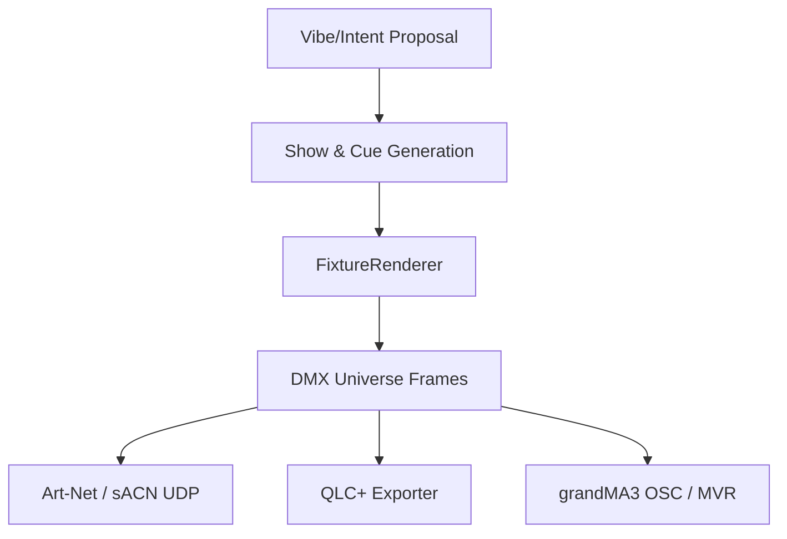

# RayFlow Codebase Map

This document bridges RayFlow's lighting design concepts and protocol specs with the actual python implementation in `src/rayflow/`. It outlines module architecture, primary data models, and control flow pipelines.

---

## Codebase Modules Layout

The project source is structured as follows:

```text
src/rayflow/
├── cli/                 # CLI entry points and command groups
│   ├── bridge.py        # DMX output and test bridge commands
│   ├── console.py       # grandMA3 compatibility command wrappers
│   ├── fixture.py       # GDTF inspection commands
│   ├── rig.py           # Virtual stage and rig planning commands
│   ├── show/            # Show specific subcommands (cues, palettes, export)
│   └── main.py          # Root Typer CLI registry
├── design/              # Creative models, planners, and generators
│   ├── models.py        # Show, Rig, Cue, and Palette dataclasses
│   ├── rig_builder.py   # AI layout and rig proposal engine
│   ├── cue_generator.py # Cue timing and step generator
│   ├── preview.py       # Dry-run validation and critique engine
│   └── library.py       # Show and Rig disk storage managers
├── engine/              # Drivers, bridge protocols, and adapters
│   ├── backends/        # Output targets (DMX, QLC+)
│   ├── bridge/          # Network bridges (Art-Net, sACN)
│   ├── console/         # grandMA3 export and OSC controllers
│   ├── fixtures/        # GDTF parsers, patching, and MVR/QXF exporters
│   └── rendering/       # Fixture-aware cue-to-DMX rendering engine
├── config.py            # Global configuration and environment settings
└── cli.py               # Main runtime runner
```

---

## Core Data Flows

RayFlow operates through two primary pipelines:

### 1. Show Design & Generation Pipeline
1. **Define Rig**: Rig configuration is defined in YAML (`RF_Rig`) containing fixture lists and coordinates.
2. **Build Show/Cues**: User input or AI generates vibe parameters (`VibePalette`) and cue descriptions.
3. **Render to DMX**: The `FixtureRenderer` reads the cue intent and fixture GDTF maps to generate universe/channel frames (0-255 arrays).
4. **Export/Push**: Output is sent live via Art-Net/sACN, written as QLC+ workspaces (`.qxw`), or pushed to grandMA3 via OSC/MVR.



### 2. Output & Adapter Contracts
All output destinations implement the `BackendAdapter` contract, ensuring uniform execution:
* **Dry-Run**: Returns the expected DMX changes without writing to hardware/network.
* **Apply**: Transmits the packets or writes the export files.
* **Evidence**: Generates a structured log packet confirming the exact output state for validation.

---

## File Pointers

* **Show Models**: [models.py](file:///Users/connorkitchings/Desktop/Repositories/rayflow/src/rayflow/design/models.py)
* **Fixture Rendering Engine**: [dmx.py](file:///Users/connorkitchings/Desktop/Repositories/rayflow/src/rayflow/engine/rendering/dmx.py)
* **GDTF Parsing Engine**: [parser.py](file:///Users/connorkitchings/Desktop/Repositories/rayflow/src/rayflow/engine/fixtures/parser.py)
* **Output Adapters**: [control-backend-direction.md](file:///Users/connorkitchings/Desktop/Repositories/rayflow/docs/architecture/control-backend-direction.md)
